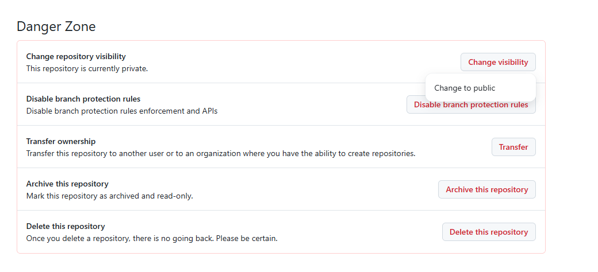
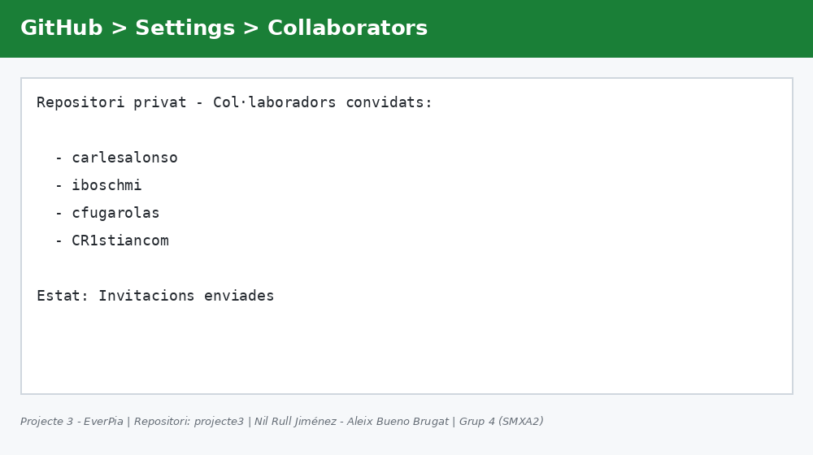
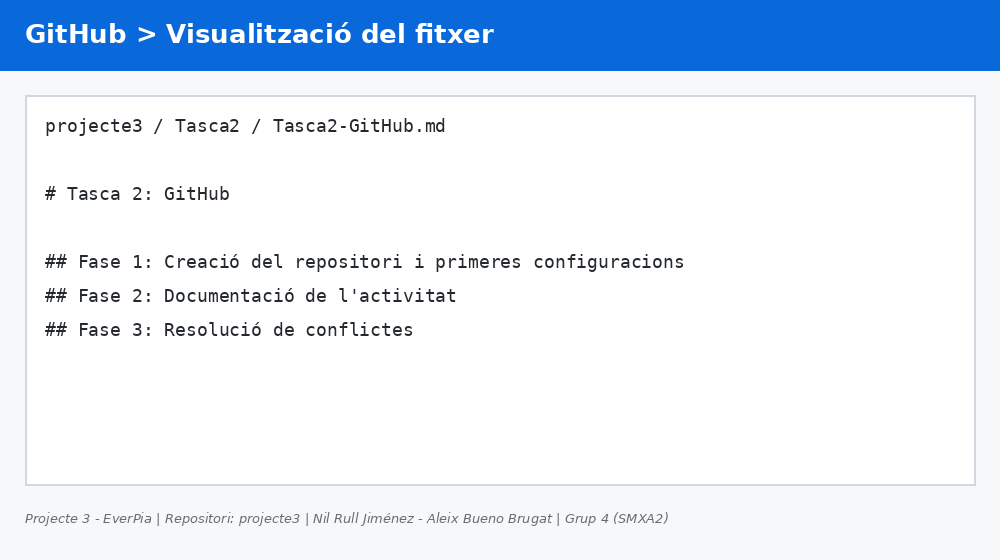
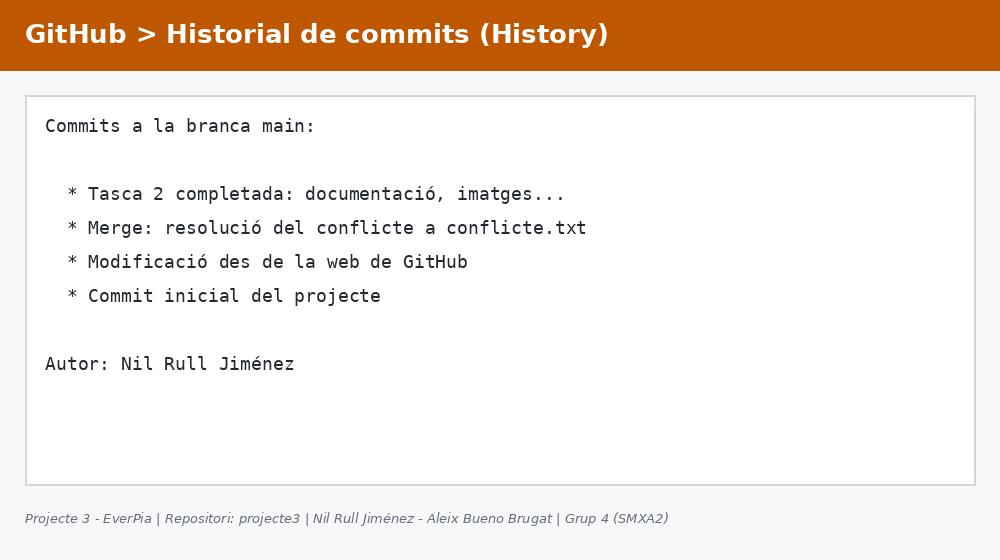
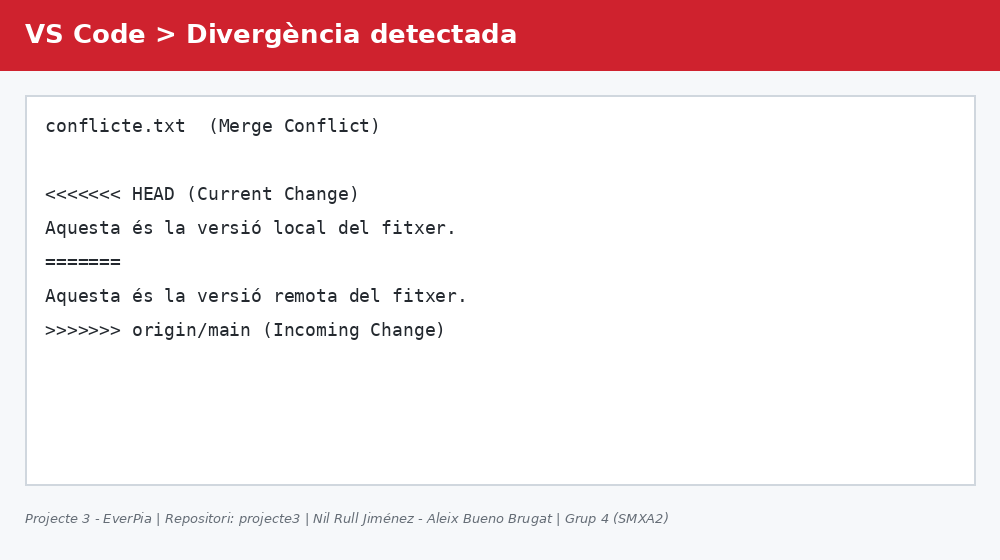
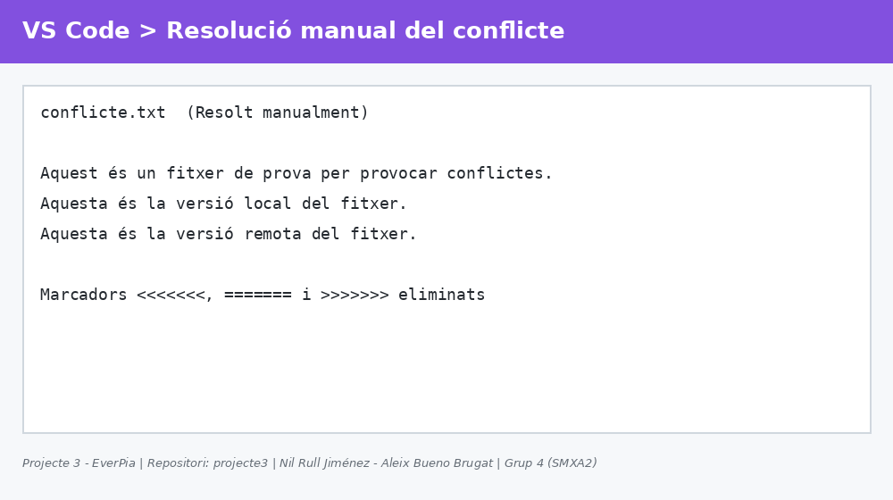
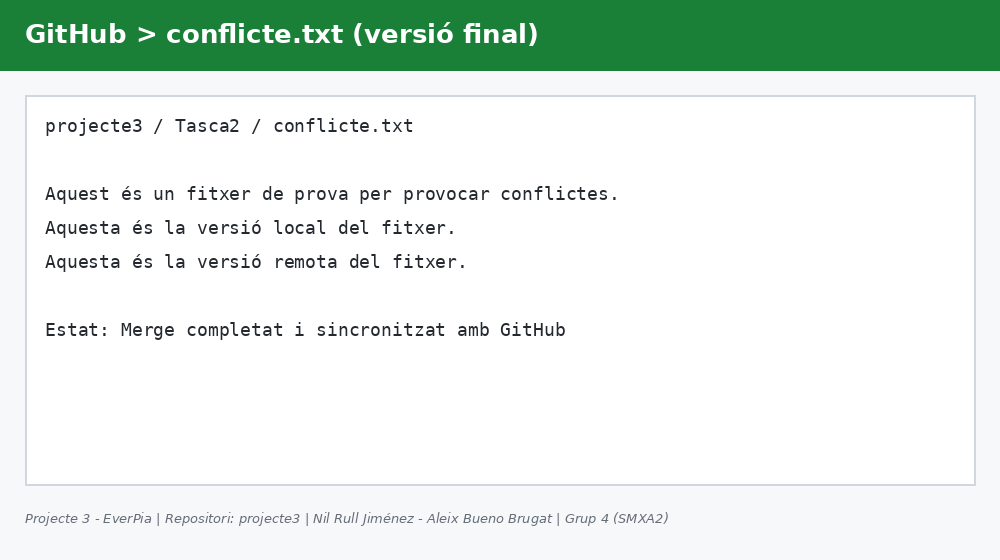

# Tasca 2: GitHub

**Alumne:** Nil Rull Jiménez
**Company de grup:** Aleix Bueno Brugat
**Grup / Classe:** Grup 4 (SMXA2)
**Projecte:** Projecte 3 - EverPia
**Repositori:** projecte3

---

## Fase 1: Creació del repositori i primeres configuracions

En aquesta primera fase s'ha creat el repositori remot a GitHub i s'han realitzat les configuracions inicials necessàries perquè el projecte pugui ser compartit i avaluat pel professorat.

### Settings > General

Dins de l'apartat **Settings > General** del repositori es pot comprovar i gestionar el nom del repositori, que en el nostre cas és **`projecte3`**. Aquest nom és l'identificador que s'utilitza a la URL del repositori remot i és el mateix que s'ha fet servir per al repositori local, de manera que ambdós queden correctament vinculats. En aquesta mateixa pantalla també es poden revisar altres paràmetres generals, com ara la descripció, la visibilitat o la branca per defecte.



### Settings > Collaborators

El repositori s'ha configurat com a **privat**, de manera que només hi poden accedir les persones que hi hagin estat convidades explícitament. Des de **Settings > Collaborators** s'han enviat invitacions als professors perquè puguin revisar el projecte i la seva evolució. Els usuaris convidats són:

- `carlesalonso`
- `iboschmi`
- `cfugarolas`
- `CR1stiancom`

Un cop enviades les invitacions, cada professor ha d'acceptar-la per obtenir accés al repositori.



---

## Fase 2: Documentació de l'activitat

### Commit i sincronització inicial

Després de configurar el repositori, s'ha realitzat el **commit inicial** des del repositori local i s'ha sincronitzat amb GitHub mitjançant les ordres habituals de Git (`git add`, `git commit` i `git push`). Amb aquest procés, els fitxers creats localment han quedat pujats al repositori remot i són visibles per als col·laboradors.

### Visualització del fitxer a GitHub

Un cop feta la sincronització, es pot comprovar a la interfície web de GitHub que el fitxer `Tasca2-GitHub.md` s'ha pujat correctament i que GitHub l'interpreta i el renderitza com a document Markdown, mostrant-ne els títols, les seccions i el format esperat.



### Historial de commits a GitHub

A l'apartat **History** del repositori es pot consultar la llista completa de commits realitzats, amb el seu missatge, l'autor i la data. **La informació que es mostra a l'historial és la correcta**: els commits apareixen amb els missatges descriptius que hem indicat, estan associats al nostre usuari i segueixen l'ordre cronològic esperat, cosa que confirma que la sincronització s'ha dut a terme sense errors.



---

## Fase 3: Resolució de conflictes

En aquesta fase s'ha provocat de manera intencionada un conflicte de fusió (*merge conflict*) per aprendre a detectar-lo i resoldre'l. El procés s'ha dut a terme pas a pas de la manera següent.

### Pas 1: Creació del fitxer `conflicte.txt`

Es va crear al repositori local el fitxer `conflicte.txt` amb una primera línia de contingut:

```
Aquest és un fitxer de prova per provocar conflictes.
```

Després es va fer el commit corresponent i es va pujar a GitHub amb `git push`, de manera que el fitxer quedés present tant al repositori local com al remot.

### Pas 2: Modificació local

Des de l'editor local (VS Code) es va afegir una segona línia al fitxer `conflicte.txt`:

```
Aquesta és la versió local del fitxer.
```

Aquest canvi es va confirmar amb un commit local, **sense** fer `git push`, de manera que el repositori local va quedar per davant del remot.

### Pas 3: Modificació des de la web de GitHub

Tot seguit, directament des de la interfície web de GitHub, es va editar el mateix fitxer `conflicte.txt` en el repositori remot, afegint a la mateixa posició la línia:

```
Aquesta és la versió remota del fitxer.
```

I es va fer el commit des de la mateixa web. D'aquesta manera, el repositori local i el remot van modificar la mateixa zona del fitxer de forma diferent, generant una **divergència** entre ambdós.

### Pas 4: Detecció de la divergència a VS Code

En executar la sincronització (`git pull`) des de VS Code, Git va detectar que les dues versions del fitxer eren incompatibles i va marcar el fitxer com a conflicte. VS Code mostra les dues versions amb els marcadors `<<<<<<<`, `=======` i `>>>>>>>`, i ofereix opcions per acceptar el canvi actual, l'entrant o ambdós.



### Pas 5: Resolució manual de les línies

Per resoldre el conflicte es va editar manualment el fitxer, eliminant tots els marcadors de conflicte i conservant les línies de les dues versions, de manera que el contingut final de `conflicte.txt` va quedar així:

```
Aquest és un fitxer de prova per provocar conflictes.
Aquesta és la versió local del fitxer.
Aquesta és la versió remota del fitxer.
```



### Pas 6: Commit final de merge

Un cop resolt el conflicte, es va marcar el fitxer com a resolt amb `git add conflicte.txt` i es va crear el **commit de merge** que finalitza la fusió. Finalment, es va executar `git push` per pujar el resultat a GitHub. En comprovar el fitxer al repositori remot, es veu que conté la versió final amb les tres línies, i que l'historial reflecteix el commit de merge.



---

## Conclusió

Amb aquesta tasca s'ha treballat el cicle complet de col·laboració amb GitHub: creació i configuració d'un repositori privat, convidar col·laboradors, sincronitzar canvis locals i remots, consultar l'historial de commits i, finalment, detectar i resoldre manualment un conflicte de fusió.
